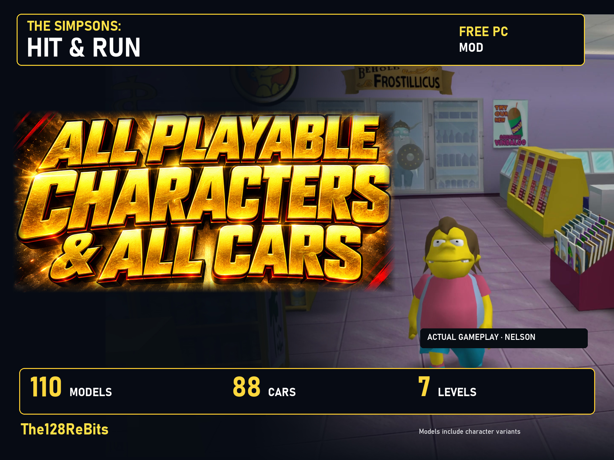

# All Playable Characters & All Playable Cars

**110 selectable models, 88 free cars, all seven levels. A free PC mod by The128ReBits.**

I wanted more ways to explore Springfield: Nelson, Hans Moleman, Ralph and many more, with cars you normally see driving past. This project goes beyond unlocking a list. I worked on model adaptation, shops, 414 scaled copies, missing vehicle pictures and original voice recordings selected for the game's events.

**[Download the complete package 1.3.12 on ModDB](https://www.moddb.com/mods/all-playable-characters-all-playable-cars/downloads/all-playable-characters-all-playable-cars-package-1312)** · [Full character selector](https://www.youtube.com/watch?v=sALClwZWTbE) · [Hans Moleman gameplay in Spanish](https://www.youtube.com/watch?v=6_BKARKSDNM)

## What you can do

- Choose 110 models, counting characters and their variants, in clothing shops.
- Call 88 free cars, including traffic vehicles, from phone booths in all seven levels.
- Use optional size adjustments to fit the level protagonist's animations, or disable them.
- Choose basic voices/actions or an expanded repertoire prepared for 42 native event types. Voices and expanded actions can be disabled.
- Keep original story conversations. Repertoires use original game recordings, never synthetic voices. Some models use documented generic voice assignments; not every model speaks in every situation.

## Installation

You need your **own complete PC game and Lucas' Mod Launcher**. The game is not included and Simpsons.exe is not modified.

1. Download the complete RAR, then extract it outside the game folder. GitHub's automatic **Source code** archives contain this documentation, not the playable package.
2. Keep `Instalar_Juega_con_cualquiera.exe`, `Motor`, `Contenido` and `PAQUETE.json` together. Close the game and Lucas.
3. Run the installer, choose the game folder and installed dub, and follow its guide. Missing Lucas can be downloaded from its [official source](https://launcher.donutteam.com/).
4. Choose all four official voice repertoires or only the selected one. Open Lucas from the prepared profile/shortcut and follow the included instructions.
5. For Latin American Spanish, install **SHARLatino 0.8 by Jebano separately first**, then generate the local adaptation with this installer. His mod and recordings are neither included nor downloaded. Sections retained in Spain Spanish stay that way.

The installer and guides support Spanish, English, Portuguese, French, German, Italian and Polish. File checks, backups, undo/uninstall and package-specific instructions help with installation. Motor includes official Python and readable installer source.

## Languages: what I have actually tested

I've played in Spain Spanish, English and Latin American Spanish through SHARLatino. French/German resources are prepared and their files checked, but I haven't managed to start my installations with menus in those languages and haven't tested their voices. Those gameplay tests are incomplete. If you play in French or German, your reports would really help me check it. Thank you!

## A separate, optional graphics remaster

This mod works **without the remaster and without its 1.3.12 update**. My [Hit & Run Remastered — Definitive Edition](https://www.moddb.com/mods/the-simpsons-hit-run-definitive-edition-by-the128rebits) is a separate download. To combine them, install the remaster first, then this package with its own installer.

The linked gameplay shows my remastered textures and optional DLSS 5 Feeder, an external neural graphics pass. It is not native DLSS or frame generation, can change the image and use substantial GPU resources, and promises no FPS gain. Faithful ReShade is an alternative. The remaster uses AI-assisted texture upscaling with manual selection; promotional text/lettering has also used AI assistance. Voices are original recordings.

## Version and reports

**1.3.12 is the distribution package number.** Internal versions differ: character mod Meta.ini 1.3.9, PAQUETE.json 1.3.10, installer engine 3.1.0. Package checks are not new gameplay tests.

Use this repository's **Issues** tab. Include language, package/component version, level or mission, model/car, other mods and steps to reproduce. Attach a screenshot or short clip when helpful; don't upload game archives or SHARLatino recordings.

## Español

Soy The128ReBits. Este mod gratuito permite recorrer los siete niveles con **110 modelos contando variantes y 88 coches gratis**, incluidos los de tráfico. Lleva adaptación de modelos, 414 copias a escala, imágenes de cabina y repertorios preparados con grabaciones originales para los eventos del juego. No se han generado voces sintéticas y no todos los modelos hablan en todas las situaciones.

Necesitas tu juego de PC y Lucas. Extrae todo el RAR y abre `Instalar_Juega_con_cualquiera.exe`, manteniendo Motor y Contenido a su lado. Para latino, instala antes SHARLatino 0.8 de Jebano por separado y genera la adaptación local. Su mod y sus voces no se incluyen ni descargan. El remaster gráfico es otra descarga opcional; este mod funciona sin él ni su actualización.

He jugado en castellano, inglés y latino. Francés y alemán están preparados, pero mis instalaciones siguen con menús en español y no he probado sus voces: sus pruebas jugando siguen incompletas. Para reportar, indica idioma, versión, nivel/misión, personaje/coche, otros mods y pasos para reproducirlo. ¡Gracias por ayudarme a comprobarlo!

## AI assistance and human review

Claude Code assisted development of this character mod, with Codex as additional support. I spent dozens of hours on model/scale adaptation, voice research and selection, review and manual playtesting. Voice recordings are original game recordings, not generated speech. AI assistance also applies to documentation and promotional text/media. The gameplay/language limits above still apply.

## Alternative manual edition

The Release also has a separate LMLM prepared for Donut Team review, an English/Spanish manual and a small readable offline source tool for optional local SHARLatino preparation. The base LMLM includes the four official repertoires but does not prepare Latino automatically. The generated local adaptation must not be redistributed without Jebano's permission. No installer, Python runtime, proxy DLL or external loader is included in this alternative. See the Release notes and manual for the exact differences; Donut Team has not approved it yet. File/preparation checks are not new gameplay tests of this edition.

## Credits and development

Project and improvements: **The128ReBits**. Lucas' Mod Launcher and tools: Lucas Cardellini / Donut Team. SHARLatino: Jebano. Original game, models, cars and dubs: Radical Entertainment / Vivendi Universal Games and Fox. Full component credits and licences are included in the package. These credits do not grant new rights over third-party assets. Unofficial fan project.

Follow the next videos, share the mod with someone who remembers Springfield, or support future improvements if you want. The mod is free either way.

[YouTube](https://www.youtube.com/@The128ReBits) · [Instagram](https://www.instagram.com/The128ReBits/) · [TikTok](https://www.tiktok.com/@the128rebits) · [Patreon](https://www.patreon.com/cw/The128ReBits) · [Ko-fi](https://ko-fi.com/the128rebits) · [All links](https://linktr.ee/the128rebits)

